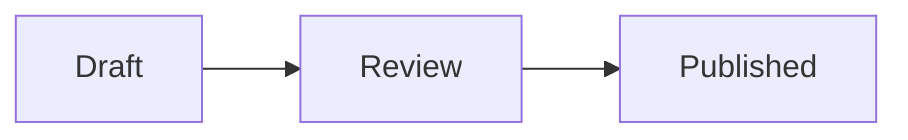

This page covers the Docs backend. Native Craft Word and Sheet documents use
[Word and Sheet editing](/guides/artifacts/word-and-sheet).

## Formatting

Every Docs page records its content schema. Each schema keeps its exact rules,
so a document never changes meaning on its own:

| Schema | Holds |
| --- | --- |
| 2 | Headings (levels 1–3), paragraphs, bulleted and numbered lists, simple tables |
| 3 | Schema 2 plus web links, inline code and code blocks |
| 4 | Schema 3 plus **bold**, *italic* and ~~strikethrough~~ (combinable, and with links), a language on each code block, block quotes and checklists |
| 5 | Schema 4 plus underline, a text colour and a highlight, each combinable with the other marks, and inline dates and mentions |

In a schema 4 document the toolbar offers Bold, Italic, Strikethrough, Quote,
Checklist and a language for the current code block. Tick a checklist item to
mark it done.

The documents engine can write a schema 4 document as Markdown (`**bold**`,
`*italic*`, `~~strike~~`, fenced code with its language, `>` quotes and
`- [x]` checklists), but no API, CLI command or Docs menu offers a Docs
download yet, so the Docs page shows no export.

### Code blocks

Code blocks use a monospace font and scroll sideways instead of wrapping. A
header above the code shows its language (in schema 4) and **Copy**, which
puts the block's exact characters on the clipboard: tabs, trailing spaces and
newlines included. Copy works for readers too.

In a schema 4 document, code in a known language is coloured as you type:
Bash, C, C++, C#, CSS, Go, GraphQL, HTML/XML, Java, JavaScript, JSON, Kotlin,
Lua, Makefile, Markdown, Perl, PHP, Python, R, Ruby, Rust, SCSS, Shell, SQL,
Swift, TypeScript, YAML and a few more, including short names such as `ts`,
`py`, `sh` and `yml`. The language field suggests common names; any short
lowercase name can be typed, and an unknown one stays uncoloured.

- Colours are only how the editor shows the text. They are never saved, never
  sent to collaborators and never appear in exports; the stored code, its
  revision and comments on it stay exactly what was typed.
- Code is never run. Markup such as `<script>` in a block stays text.
- Blocks longer than 20 000 characters are shown without colours so typing
  stays responsive.

Every Docs page offers Paragraph and Heading 1, 2 and 3. In a schema 5
document the toolbar also offers Underline, Text colour and Highlight, and
**Clear formatting**, which removes bold, italic, underline, strike, colour,
highlight and inline code from the selection and keeps links. A toggle shows as
pressed when the whole selection has that formatting, and as partly pressed
(dashed outline) when only some of it does; pressing it then applies it to all
of the selection. The colour menus keep your selection visible while they are
open; **Default** removes the colour. Shortcuts: `Ctrl+B` / `⌘+B` bold,
`Ctrl+I` italic, `Ctrl+U` underline, `Ctrl+Shift+S` strike, `Ctrl+E` inline
code, `Ctrl+\` clear formatting, `Ctrl+Z` undo and `Ctrl+Shift+Z` redo. Undo
takes back only your own changes, never another person's.

Schema 5 colours come from a fixed palette of eight names (gray, red,
orange, yellow, green, blue, purple, pink). The document stores the name, never
a CSS value, and light and dark themes each show their own readable shade of
it. Markdown has no syntax for these marks, so Markdown export writes
`<u>…</u>`, `<span data-text-color="red">…</span>` and
`<mark data-highlight="yellow">…</mark>`; most Markdown viewers show underline
and highlight and show coloured text plainly. Word export uses the light
theme's shades.

A schema 5 date is one calendar day (`2026-11-20`), shown in each reader's own
date format. A mention stores only the person's id, never their name: each
reader sees the name of a person who can read the document, and anyone else,
including someone without access, appears as **Unknown member**, so a document
never reveals whether a person exists. Markdown and Word export write the date
as `2026-11-20` and a mention as `@` and a name only when the export is given
the names the exporting reader may see; otherwise as `@Unknown member`. The
export serializers accept those names, but no export endpoint supplies them in
this release, so exported mentions read `@Unknown member` for now. A semantic
`replaceText` edit that would insert text exactly beside a date or mention, or
delete across one, is refused with `ambiguous_inline_atom`; make that edit in
the editor.

A document becomes schema 4 or 5 only explicitly: initialize it with `"schema": 4`
(see [`crewship doc initialize`](/cli/doc)) or `"schema": 5`, or upgrade an older
document through the documents service's human-only upgrade, which always goes
to the newest schema (5), keeps its content, history and comments and only
widens what it may hold. Restoring a version from before that upgrade keeps
the document at schema 5, so it never silently returns to schema 4. An editor
that does not know a document's schema opens it read-only with "This document
needs a newer editor" and never saves over it.

New documents start at schema 5: the New Doc dialog, the Artifacts library and
documents an agent creates from chat. Existing documents keep their schema
until someone with edit access upgrades them. The agent run that created a
document with your drafting permission edits it directly; any later agent
request on a schema 4 or 5 document is a proposal at that document's schema,
which a person accepts or rejects. Accepting keeps underline, colours,
highlights, dates and mentions outside the changed text.

### Math

A schema 4 code block whose language is `latex` (or `math`) is shown as a
typeset formula. **Source** and **Preview** in the block's header switch
between the formula and its LaTeX; the choice is yours alone, only in this
tab, and never changes the document. Putting the caret into a formula shows
its source, so you always see what you type. Readers see the formula too.

- Math is block math: one display formula per code block. Inline math inside
  a paragraph is not available yet; it needs a new kind of content and will
  come with a later document schema.
- The formula is drawn by KaTeX, bundled with the app at a fixed version
  with its fonts, so showing it loads nothing from other sites. Commands that
  could link, load or style (`\href`, `\url`, `\includegraphics`,
  `\htmlClass`, `\htmlStyle` and similar) are refused and shown as plain
  text.
- A formula KaTeX cannot read shows *Cannot show this formula* with the
  reason, above its source, in that block only; the rest of the page is
  unaffected and nothing is changed. Sources longer than 10 000 characters
  are shown as source only.
- The stored content stays the LaTeX source, so history, comments, Copy and
  agents see exactly what was typed.

### CSV and Markdown previews

Two more languages opt a schema 4 code block into **Source** and **Preview**:

| Language | Preview |
| --- | --- |
| `csv` | A table; the first row is its header |
| `markdown` or `md` | Formatted Markdown (GitHub flavour) |

Only blocks with one of these languages are rendered. Every other code block,
including Markdown pasted into a `python` or unlabelled block, stays code.

- CSV is read strictly (RFC 4180): commas separate cells, a cell containing a
  comma, quote or line break is wrapped in double quotes, and `""` is a quote
  inside it. A stray quote, an unclosed quote or a row with a different number
  of cells than the header is reported with its line, and the source stays
  shown. At most 500 rows, 50 columns, 2 000 characters per cell and
  100 000 characters in all.
- Markdown shows headings, emphasis, strikethrough, inline and fenced code,
  lists and checklists, quotes, rules, tables and links. Raw HTML is shown as
  the characters that were typed, never as HTML. Images are shown as
  *[Image: description]* and are never loaded. Only `http`, `https` and
  `mailto` links become links; they open in a new tab. At most 20 000
  characters, 12 levels of nesting and 5 000 elements.
- Cells and text are only ever text in the page: nothing in a CSV cell or a
  Markdown source can add markup, run script or fetch anything.

### Diagram and chart previews

Two more languages opt a schema 4 code block into **Source** and **Preview**:

| Language | Preview |
| --- | --- |
| `mermaid` | A diagram drawn by Mermaid (flowcharts, sequence, class, state, Gantt and the other Mermaid types) |
| `chart` | A bar or line chart from a small JSON spec |

````

````

A `chart` block holds exactly this shape; `title` is optional:

```json
{
  "type": "bar",
  "title": "Runs per week",
  "x": ["W1", "W2", "W3"],
  "series": [
    { "name": "Research", "values": [12, 18, 9] },
    { "name": "Support", "values": [7, 4, 11] }
  ]
}
```

- Mermaid is bundled with the app at a fixed version and loads only when the
  first diagram is shown. It never draws in the page itself: it draws in a
  hidden frame whose security policy allows no requests at all, so whatever a
  diagram's styles or shapes name (images, icons, masks, fonts), the browser
  does not fetch it, from other sites or from the app. Text labels only:
  `click` callbacks and links do nothing, HTML in labels stays text, and a
  diagram's own `%%{init}%%` directive or front matter cannot change these
  settings or restyle the page. The drawn SVG is cleaned again before it is
  shown (no scripts, links, embedded HTML, images, `use` references, overlays
  or styles that load a URL) and is kept in its own isolated subtree, so its
  styles only affect the diagram.
- As a second layer, a diagram that names something to load is refused with
  *Cannot show this diagram: it refers to an image, icon, URL or escaped
  text*: image and icon shapes (`A@{ img: … }`, `A@{ icon: … }`, quoted keys
  too), sequence diagram `properties`, `url(…)`, `image-set(…)`,
  `cross-fade(…)` and `image(…)` in styles and class definitions, and any
  backslash.
- Diagrams are drawn one at a time. At most 5 000 characters, 150
  connections (arrows and links, in every diagram type), 300 statements, 50
  subgraphs and nesting 6 deep (subgraphs or composite states). When a
  diagram takes longer than half a second to draw (or to fail), edits by
  others no longer redraw it automatically: the block says *The source
  changed* and redraws when you choose **Preview**. Once previews on one page
  have taken a second in all, further blocks show their source and say
  *Previews on this page took long to draw*; choose **Preview** to draw one.
- A chart is read strictly: `type` is `bar` or `line`, `x` lists the
  category labels, and every series has a `name` and one finite number per
  label. Unknown keys, wrong types and specs over the limits are refused with
  the reason. At most 8 series, 200 points per series, 200 characters per
  label or name, values up to ±1e300 and 50 000 characters in all. Labels
  are only ever text.
- Series use the product's chart colours, in order. The chart is announced to
  screen readers with a summary (type, title, series, categories and value
  range); **Show data table** under it lists every value, and hovering a bar
  or point shows its value.
- A diagram or chart that cannot be drawn shows *Cannot show this diagram* or
  *Cannot show this chart* with the reason, above its source, in that block
  only. Switching between Source and Preview never changes the document.
- Comments on a diagram or chart anchor to text in its source, as in any code
  block. Commenting on a single diagram node or chart bar is not available:
  it needs a new kind of content and will come with a later document schema.

New Docs use schema 5. Older documents upgrade only when a person explicitly chooses to upgrade; content, history and comments are kept. Agent drafting and proposals follow the capability table for the document’s own schema.

## Editing together

Several people can type in one Docs page at the same time, also in the same
paragraph. Every editor merges the others' changes as they arrive (about every
half second) and keeps your caret on the character you typed last, so your own
text stays in the order you typed it wherever the others type.

Everyone who has the page open shows in the header as a round mark in their
colour (hover it, or use a screen reader, for the name), and their caret shows
in the text as a thin bar of that colour with their name above it; a selected
range is tinted in the same colour. Names come from the workspace, not from
the other person's browser. Presence is not stored anywhere: it disappears
within a few seconds of somebody leaving, and at once for a person whose
access is removed. Readers and commenters are shown too; nobody sees who is
on a document they cannot read.

The status chip says **Saved** only when the server has confirmed your changes
and its confirmed copy holds everything in your editor. If it lacks something,
editing stops, the chip shows an unsaved draft and offers **Download my
changes**; that state is never reported as saved.

## Comments

Select text in a paragraph, heading or code block and choose **Comment** to
start a thread on it. The **Comments** tab lists threads in document order with
their quoted text, replies and who wrote them. Reply under a thread, or
**Resolve** it; resolved threads stay listed under *Resolved* and can be
reopened.

- Anyone who can read the document can read its comments.
- Commenting, replying and resolving need Comment or Edit access. On private
  output only its owner comments; a workspace owner's audited read never
  includes commenting.
- Restricted members can read comments on output in their custody but
  cannot comment, reply or resolve, the same as editing.
- A document holds at most 1000 comments (threads and replies, 10 000
  characters each); each thread can be resolved or reopened 100 times. A
  commenter does not share the editors' save rate limit. Comments count
  toward the workspace's artifact storage budget.
- Comments never change the document's content or revision. When the quoted
  text is edited the thread follows it; when it is deleted the thread shows as
  *text removed*.

From the CLI: [`crewship doc comments`](/cli/doc), `crewship doc comment` and
`crewship doc comment-resolve`.
